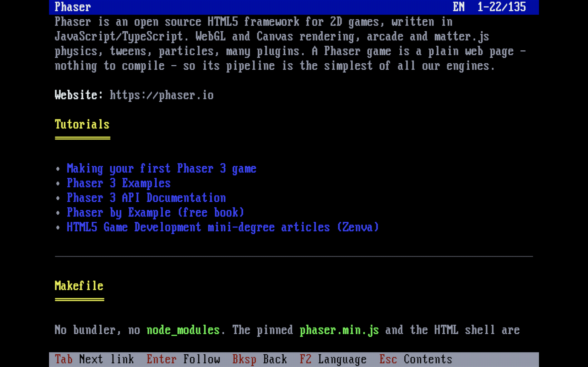

# TTGWIKI – the Teletype Games wiki on DOS

TTGWIKI reads the public pages of the [Teletype Games wiki](https://wiki.teletypegames.org) on DOS (`TTGWIKI.EXE`, mTCP over a packet driver) and on Windows 95 and later (`TTGWIKIW.EXE`, Winsock, in a console window). A DOS machine cannot speak HTTPS, so the server side of this repository exports the wiki as plain text files, and the Teletype Games FTP server ([infra/ftp-server](https://git.teletypegames.org/infra/ftp-server)) shares them over anonymous, read-only FTP, next to [DOSINST](https://git.teletypegames.org/dos/dosinst)'s store. TTGWIKI downloads a page when it is read and keeps it, so a page read once can be read again offline; `F6` (or `TTGWIKI SYNC`) downloads every page.

```
 wiki.teletypegames.org (Grav)
        │  /custom/sitemap.json, /custom/page.json (inside the wiki's docker network)
        ▼
 exporter (server/export.py)   at start, then every 15 minutes
        │  WIKI.INI, EN/INDEX.TXT, EN/FILES.LST, EN/P0000001.TXT, ... HU/...
        ▼
 FTP (infra/ftp-server)        ftp://ftp.teletypegames.org/WIKI, anonymous, read-only
        │
        ▼
 TTGWIKI.EXE / TTGWIKIW.EXE    CACHE\EN\..., CACHE\HU\... next to the executable
```

Only the public pages are exported: a page that is login-protected on the wiki (or sits under one) never leaves the server.



## Files

| File | Purpose |
|---|---|
| `TTGWIKI.EXE` | The program for DOS (16-bit, 8086, about 95 KB). |
| `TTGWIKIW.EXE` | The same for Windows 95 and later (32-bit console program). |
| `TTGWIKI.CFG` | The settings (optional: without it the defaults below are used). |
| `CACHE\` | *Made at runtime*, next to the executable: the downloaded pages, a folder per language. It can be deleted at any time. |
| `SOURCE/` | The client's source (C++, Open Watcom), in layers (see [Structure](#structure)). |
| `server/` | The server side: the exporter (`export.py`, `render.py`), Python. |
| `compose.yaml` | The server side's stack: the exporter. |

## Installation

- **With DOSINST**: install `TTGWIKI` (DOS) or `TTGWIKIW` (Windows) from the [DOSINST](https://git.teletypegames.org/dos/dosinst) program store. An update keeps `TTGWIKI.CFG` and the downloaded pages (DOSINST keeps the files it did not install).
- **By hand**: unzip `TTGWIKI-<version>.zip` (or `TTGWIKIW-<version>.zip`) from the [releases](https://git.teletypegames.org/dos/ttgwiki/releases), for example to `C:\TTGWIKI`.

The DOS build needs a packet driver and mTCP's configuration (`MTCPCFG`, filled in by mTCP's `DHCP.EXE`), as DOSINST does; see DOSINST's README for DOSBox and for real machines. In a DOS window of Windows 95/98 Windows owns the network card: use `TTGWIKIW.EXE` there.

## Usage

```
TTGWIKI                    browse the wiki
TTGWIKI SYNC [lang]        download every page of a language, to read them offline
TTGWIKI SHOW route [lang]  print a page as plain text: TTGWIKI SHOW /dos/gmenu > PRN
```

**The contents** list the pages as a tree, with the date of their last change. A page that has no translation is shown in the language it is written in, marked with that language (`[en]`).

| Key | |
|---|---|
| Up/Down/PgUp/PgDn/Home/End | select a page |
| Enter | read it |
| typing | search the titles (and the routes), ignoring case and accents; Backspace deletes, Esc clears |
| F2 | the other language |
| F5 | look for a new export |
| F6 | download every page of the language |
| Esc | quit |

**The reader** shows a page as the wiki has it: headings, lists, code blocks, quotes and tables, in colors.

| Key | |
|---|---|
| Up/Down/PgUp/PgDn/Home/End | scroll |
| Tab / Shift+Tab | select the next / previous link; the status line tells where it goes |
| Enter | follow the link (a web link is only shown: open it on another machine) |
| Backspace, Left | back to the page before |
| F2 | the same page in the other language |
| F5 | look for a new export |
| Esc | back to the contents |

At start, and on F5, TTGWIKI reads `WIKI.INI` from the server. When its generation is the one already on the disk, nothing else is downloaded. When it is new, the new page list comes, and the pages on the disk that changed are deleted, so they are downloaded again when they are read. When the server cannot be reached, TTGWIKI shows the error and works from the disk.

## Settings: TTGWIKI.CFG

`TTGWIKI.CFG` is read from the folder of `TTGWIKI.EXE`.

| Key | Default | |
|---|---|---|
| `SERVER` | `ftp.teletypegames.org` | the FTP server of the export |
| `PORT` | `21` | |
| `USER`, `PASSWORD` | `anonymous`, `ttgwiki@` | |
| `PATH` | `/WIKI` | the folder of the export on the server |
| `LANG` | `EN` | the language at start: `EN` or `HU` |
| `CODEPAGE` | `437` | the code page of the screen: `437` (US), or `852` (Central European, with every Hungarian letter). In 437 the letters it lacks become a near one (ő → ö, ű → ü). |
| `CACHE` | `CACHE` next to the executable | where the pages are kept |

## The export

The exporter (`server/export.py`) reads the wiki's JSON API, the endpoints the [wiki BBS](https://wiki.teletypegames.org/infrastructure/wiki-site) reads too, inside the wiki's docker network. It exports at start and then every `INTERVAL` seconds (900); a restart exports again. An export is written only when something changed: the new folders are put together in `.next`, swapped in with renames, and `WIKI.INI` comes last with the next generation number. A failed run (the wiki down) changes nothing.

```
WIKI.INI          [wiki] format=1, generation, exported, languages=EN,HU, width=78
EN/INDEX.TXT      the page tree
EN/FILES.LST      "crc32 size name" of INDEX.TXT and every page (DOSINST's format)
EN/P0000001.TXT   a page
HU/...
```

The files are UTF-8 with CRLF line ends; TTGWIKI turns them into the code page of the screen, one byte for every character.

- **`INDEX.TXT`**: a page per line in tree order (a parent before its children), tab-separated: `id`, `parent id` (0: none), `depth`, `modified` (Unix time), `locale` (the language the page is written in), `route`, `title`.
- **A page** starts with header lines, `TITLE=`, `ROUTE=`, `LOCALE=`, `MODIFIED=`, `URL=`, and `L=<n> <target>` for each link (`#<id>` for a page of the export, the URL for anything else), then an empty line, then the lines of the page.
- **A line of a page** has at most 78 characters. Control bytes, which take no column, mark the styles and the links: `01h c` starts style `c` (`0` normal, `1`-`3` headings, `b` bold, `i` italic, `c` inline code, `p` code block, `q` quote, `r` rule, `t` table frame, `h` table header), `02h n 03h` starts link `n`, `04h` ends it. Every line starts in the normal style, outside a link: a style or a link that runs over the end of a line starts again on the next one.
- **A page keeps its id**: the ids are read back from the `INDEX.TXT` files of the export, a new route gets the next number. The two languages share the ids, so F2 can show the same page.

`server/render.py` turns the HTML of a page (Grav's rendered `content`) into these lines: paragraphs and lists wrapped, code blocks kept (a longer line goes on after `»`), tables drawn with frames when they fit (their cells wrapped) or as "column: value" lines when they do not, images as `[Image: alt text]`. A link to a page that is not exported is plain text.

## The server

`compose.yaml` runs the exporter (`server/Dockerfile`), without root and with a read-only file system. It writes the export into the `WIKI` folder of the Teletype Games FTP server (`EXPORT_DIR`, by default `/srv/stacks/ftp-server/root/WIKI`), which shares it as `ftp://ftp.teletypegames.org/WIKI`: anonymous, read-only, passive mode only. The exporter joins the wiki's network (`wiki-pages_default`), so the `services/wiki-pages` stack has to run first.

```sh
docker compose up -d --build
```

The live exporter is the `ttgwiki` stack on vps.teletype.hu (`/srv/stacks/ttgwiki`). A push to master that changes the server side deploys it (`.woodpecker/deploy.yaml`: the server's deploy user runs `ci-deploy ttgwiki`).

## Building

The build needs [Open Watcom v2](https://github.com/open-watcom/open-watcom-v2) (the `ow-snapshot.tar.xz` release). Unpack it to `~/.local/opt/watcom`, or set `WATCOM`, then:

```sh
SOURCE/build.sh
```

| | DOS: `TTGWIKI.EXE` | Win32: `TTGWIKIW.EXE` |
|---|---|---|
| Code | 16-bit, 8086, large model | 32-bit, 386, Windows 95 and later |
| Entry | `SOURCE/main_dos.cpp` | `SOURCE/main_win32.cpp` |
| Network | mTCP (`SOURCE/MTCP`) over a packet driver: `platform/dos/mtcp_network` | Winsock 1.1: `platform/win32/winsock_network` |
| Screen, keys | video memory, BIOS (`lib/platform/dos`) | a console screen buffer of its own (`lib/platform/win32`) |

## Structure

The code is in layers; each one uses only the ones below it, and only through their interfaces (`SOURCE/lib/tools/check_layers.py` checks the includes):

| Folder | Layer |
|---|---|
| `SOURCE/model` | The data and its rules, no I/O: `Config`, `WikiInfo` (WIKI.INI), `Manifest` (FILES.LST), `PageIndex` (INDEX.TXT), the lines of a page (`page_line`: styles, links), `History`, the search. |
| `SOURCE/repository` | Interfaces of the storage: the export on the server (`RemoteWiki`), the pages on the disk (`PageStore`), a page read a line at a time (`PageSource`). Their implementations: `repository/ftp` and `repository/fs`. |
| `SOURCE/service` | What TTGWIKI does: `SyncService` (the export and the disk in step: a new generation deletes the changed pages, a page is downloaded when it is read and checked against FILES.LST) and `ReaderService` (the page being read). |
| `SOURCE/controller` | The browser (`BrowserController`: the contents and the reader) and the command line (`CliController`). |
| `SOURCE/view` | The screens and the command line output. |
| `SOURCE/platform` | `exeDir` and the network adapters (mTCP, Winsock). |
| `SOURCE/app` | `runTtgwiki`: puts the layers together for a machine. |
| `SOURCE/lib` | [DOSLIB](https://git.teletypegames.org/dos/doslib) as a git subtree, shared with DOSINST, GMENU and BMAGIC: strings, INI, CRC-32, the code pages, the FTP client, the screen and the keyboard, the file system, the test helpers. |

The rules of the code (C++98 for Open Watcom, interfaces, names, format) are in `SOURCE/lib/README.md`.

## Tests

- `python3 -m unittest discover -s server/test`: the renderer (wrapping, styles, links, lists, code, quotes, the three ways of a table) and the exporter on a fake wiki (the tree, the ids that stay, the private pages, a new generation only on a change, a failed run that changes nothing).
- `SOURCE/test/unit/run.sh`: the client's unit tests on the host with its C++ compiler, on a fake server and an in-memory disk: the models, the page reader, the sync (a new generation, a bad checksum, an export that changed under a download, offline) and the browser with scripted keys. It checks the layers first.
- `SOURCE/test/run.sh`: the exporter writes a small export from a fake wiki (`server/test/fixture.py`), `SOURCE/test/ftpserver.py` shares it on the host as `WIKI`, and TTGWIKI.EXE runs in a headless DOSBox Staging: it prints pages, downloads them all, follows a new export, prints Hungarian in code page 852, reads offline, and browses with a test build (`build.sh test`) that takes its keys from `TESTKEYS` and saves the screen when they run out. `SOURCE/test/runw32.sh` does the same with TTGWIKIW.EXE under Wine, from the command line.

```sh
PYTHON=/path/to/python-with-pyftpdlib SOURCE/test/run.sh
PYTHON=/path/to/python-with-pyftpdlib SOURCE/test/runw32.sh    # needs Wine
```

## Releases

Woodpecker (`.woodpecker/warp.yaml`, a `platform: dos` marker) runs the pipeline the WarpEngine of teletypegames.org serves, with the commands of the [dos-tools](https://git.teletypegames.org/build/dos-tools) builder image (Open Watcom, DOSBox Staging, Wine, clang-format): on every push `dos-check` (the code style, the layers, the unit tests of both sides), `dos-build` (`SOURCE/build.sh`) and `dos-test` (`SOURCE/test/run.sh` and `SOURCE/test/runw32.sh`). A push to master that changes the server side deploys it (`.woodpecker/deploy.yaml`). The `vX.Y.Z` tag of a release publishes a Gitea release with `RELEASE_NOTES.md` as its text, `TTGWIKI-vX.Y.Z.zip`, `TTGWIKIW-vX.Y.Z.zip` and the two executables, and publishes the release to the WarpEngine catalog, whose DOS shelf is DOSINST's store: the engine puts both builds there (without `TTGWIKI.CFG`). What a release holds is the `dos` block of `metadata.json`.

A release is a raised version: raise `version` in `metadata.json` together with `Version` in `SOURCE/app/version.h` (the two have to match), and push it to master. The pipeline tags the commit `vX.Y.Z` itself, and that tag's pipeline makes the release. A push that leaves the version as it is only builds and tests; a tag made by hand still works, but has to match the version. Off master a push builds a `dev-` version, which never reaches the store.

```sh
# edit metadata.json and SOURCE/app/version.h, then
git commit -am "Version X.Y.Z"
git push origin master
```

## License

TTGWIKI uses the [mTCP](http://www.brutman.com/mTCP/) TCP/IP library by Michael B. Brutman, which is GPLv3, so TTGWIKI is GPLv3 too (see `LICENSE`).
